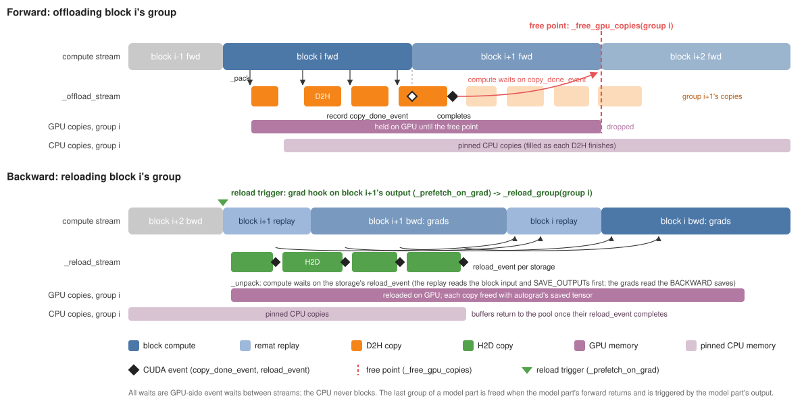
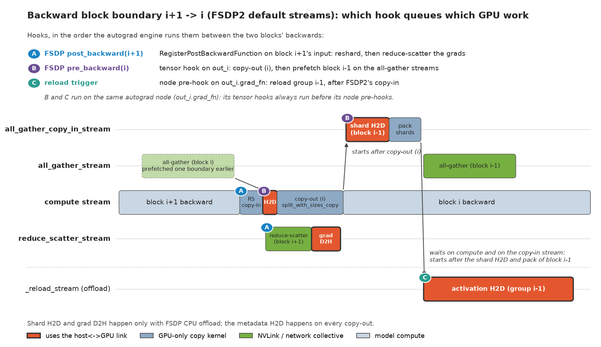
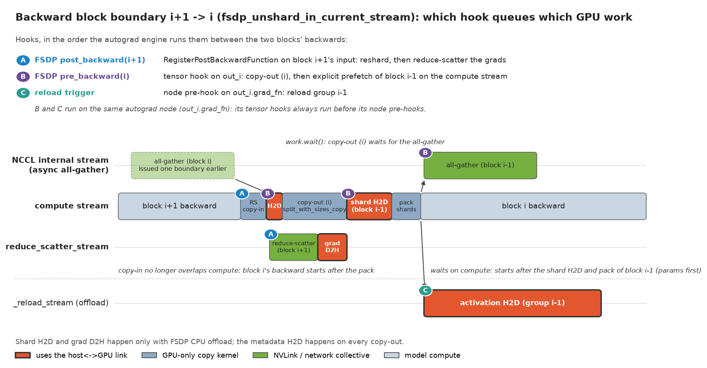

# Activation offloading

Activation offloading lowers peak memory by copying activations from GPU HBM
to CPU DRAM during forward and back during backward. This doc covers how
TorchTitan implements it (`activation_offload.py`), how it composes with remat
([REMAT.md](REMAT.md)), FSDP2, pipeline parallelism and CUDA graphs, and what
it costs.

## What is offloaded

The offloader works on **saved tensors**, the tensors autograd keeps from
forward for backward, through saved-tensor hooks: `pack` runs when a tensor is
saved, `unpack` when backward reads it.

Offloading always runs under remat. The offloader installs
`torch_remat.saved_tensors_hooks` around each transformer block's remat
checkpoint, so it sees only what remat keeps (anything remat recomputes is
never packed), and for each tensor why it is kept (`SavedTensorInfo.kind`) and
by which save region (`SavedTensorInfo.region`):

- `CHECKPOINT_INPUT`: the block input, where the backward replay starts;
- `SAVE_OUTPUT`: a save region's output, reused by the replay;
- `BACKWARD`: tensors a save region's ops keep for their own gradient.

**What to offload is part of the remat policy**: each retained region is kept
on GPU or sent to CPU, in `ActivationRematConfig`:

| Field | Default | Selects |
|---|---|---|
| `offload_block_input` | `False` | each block's input hidden state (`CHECKPOINT_INPUT` that requires grad); under full remat, the whole stash |
| `offload_regions` | `[]` | glob patterns over retained save-region names, e.g. `["attention.*"]`; `["*"]` is everything save regions retain |

Both can differ per block through `block_overrides`
([REMAT.md](REMAT.md#per-block-policies)), e.g. to offload only some blocks.
Offloading in place of recomputing is `save_regions=["*"]` plus offload: only
the cheap code outside regions is recomputed. Tensors recomputation needs but
no region retains (`recompute_needs_tensor`) stay on GPU; the first-forward
summary lists them as "outside any region", and a large amount there points
at a missing region.

**How offloading runs** is `ActivationOffloadConfig`
(`TrainingEngine.Config.activation_offload`), required exactly when the remat
policy offloads something. Its one field, `offload_last_block` (default
`False`), is covered under [The last block](#the-last-block).

Never offloaded, whatever the config:

- parameters: the module holds them, so nothing is freed, and under FSDP2 the
  copy would race with resharding;
- storages shared with the model part's input: the caller (e.g. a pipeline
  stage) holds them;
- tensors that are not plain CUDA tensors;
- storages under 1 MiB (routing metadata, loss scalars): no measurable saving.

**In-place updates.** Autograd skips its saved-tensor version check for
tensors packed by hooks, so the offloader records each save's version and
raises autograd's error at unpack if it changed. Unchecked, a save kept on
GPU would reach backward modified, and an offloaded one would race its copy.

## How it works

Queuing a copy saves no memory; dropping the GPU copy does, and that is only
safe once the copy has finished. In backward, a tensor must be back before
it is read. So everything turns on two points, and the trade-off is how much
compute each copy gets to overlap with:

- the **free point**, where the compute stream waits for a group's D2H copies
  and drops the GPU copies. Later means more copy time but higher peak
  memory; a copy still running there stalls compute.
- the **reload trigger**, which starts a group's H2D copies ahead of use. A
  copy still running when `unpack` needs it stalls compute.

All waits are GPU-side event waits between streams; the CPU never blocks.

| Term | Code | Meaning |
|---|---|---|
| offload group | `_OffloadGroup` | the storages packed by one call of one transformer block; freed and reloaded together |
| copy-done event | `group.copy_done_event` | recorded on the offload stream when the block's forward returns; completes after all of the group's D2H copies |
| reload event | `_OffloadedStorage.reload_event` | recorded on the reload stream after one storage's H2D copy |
| on-demand reload | `num_on_demand_reloads` | a storage no trigger reloaded, copied at `unpack`; each one stalls compute |

**Forward, block `i`:**

1. Block `i`'s pre-forward hook opens group `i` and enters the saved-tensor
   hooks.
2. `pack` queues each selected storage's D2H copy on the offload stream, which
   first waits on the compute stream so the copy starts after the tensor is
   produced. A storage is copied once even if several saves view it (e.g. q,
   k and v slices of a fused QKV output); each save is rebuilt as a view of
   the reloaded storage.
3. When block `i` returns, `copy_done_event` is recorded.
4. When block `i + 1` returns, group `i`'s **free point** runs: the compute
   stream waits on its `copy_done_event`, then its GPU copies are dropped.
   Group `i`'s copies overlap block `i + 1`'s forward, and at most two groups
   are on the GPU at once. The last group is freed when the model part's
   forward returns.

**Backward:**

1. Block `i + 1`'s output gradient is ready: its **reload trigger** queues
   group `i`'s H2D copies on the reload stream, each into a GPU buffer
   allocated on the compute stream (so it is freed in compute-stream order),
   and records each storage's `reload_event`. The model part's output
   triggers the last group.
2. Group `i`'s reloads overlap block `i + 1`'s backward, roughly 2x its
   forward (more with the replay), so a volume that does not stall the
   forward rarely stalls the backward.
3. Block `i`'s `unpack` makes the compute stream wait on the storage's
   `reload_event`. Each reloaded copy is freed with autograd's saved tensor.

Reloads are queued in pack order, which suits the replay: it reads the block
input and the `SAVE_OUTPUT`s first, the `BACKWARD` saves only in the gradient
pass. Queuing `BACKWARD` saves last would help only when reloads barely
finish in time (TODO).

## Design choices

**One transformer block per group**, the unit remat checkpoints. Finer groups
(attention and MLP apart) would free memory a little earlier in forward, but
under block remat that is all they would gain:

- the replay needs the whole block at once, so the backward peak does not
  change, and the first sub-group's reload loses its lookahead;
- remat packs the block input before any sub-block group opens, so it would
  never be offloaded;
- remat defers a region output's save to its first consumer, which can run
  after the producing group's free point.

Finer groups make sense only with finer remat checkpoints (Megatron does both
at submodule granularity).

### The last block

Only the loss runs between the last block's forward and its backward, so
offloading it would pay two transfers to free memory for almost no time, and
both the free point and the reload would likely stall. By default
(`offload_last_block=False`) the last block of each model part is not hooked
and keeps everything on GPU. This overrides the remat policy, including a
block override naming that block (with a warning). Offloading it pays off only
when the peak falls between its forward and backward, e.g. a large-vocabulary
loss: its activations are freed before the logits are allocated.

Under PP every stage has this problem, at every stage boundary: the forward
leaves the stage right after its last block, and that block's backward starts
as soon as the gradient arrives. `offload_last_block=False` keeps one block
per in-flight microbatch on GPU on every stage.

## FSDP2

The design borrows FSDP2's structure: per-block hooks, one stream per transfer
direction, event waits between streams, and a backward prefetch one block
ahead, triggered by a hook on the block's output gradient.

**Why not inside FSDP2.** Offload must understand torch_remat (what is saved
vs recomputed, save-region names, `is_recomputing()`); torch_remat is a
separate package, and remat concepts do not belong in pytorch/pytorch's
FSDP2. (It should also work without FSDP, a weaker reason: degree 1 FSDP
would do.)

**Hook order.** FSDP2 is applied in `parallelize` and offload afterwards, so
FSDP2's forward hooks run first:

| When | FSDP2 | then offload |
|---|---|---|
| block pre-forward | unshard parameters | open the group, enter the saved-tensor hooks |
| block post-forward | reshard; register pre-backward on the output | close the group, free the previous group, register the reload trigger |
| block output gradient ready | unshard this block, prefetch the previous block | reload the previous block's group |

In backward the order holds however they were applied: FSDP2's pre-backward
is a tensor hook on the output, the reload trigger a pre-hook on the output's
autograd node, and autograd runs a node's tensor hooks first. It matters:
unsharding runs the all-gather copy-out on the compute stream, which starts
with a small H2D copy of `split_with_sizes_copy`'s metadata. The reload
stream waits on the compute stream, so the reload queues behind that copy;
issued before it, the small copy could wait in the copy engine for the whole
reload, delaying a block that does not read it (seen on H100 in
pytorch/torchtitan#467; not reproduced on GB300).

**FSDP2 CPU parameter offload** (`CPUOffloadPolicy`) is the one FSDP2 traffic
on the CPU-GPU link: parameter shards host-to-device in each unshard's
copy-in, gradient shards device-to-host after each reduce-scatter. In
forward, its copies run opposite to the offloads. In block `i`'s backward,
block `i - 1`'s parameter shards and activations go the same direction, and
the parameters load first: FSDP2's pre-backward queues their copy-in on
`all_gather_copy_in_stream` just before the reload trigger runs, and each
reload waits on that stream (`FSDPModule.get_all_gather_copy_in_stream()`)
as well as on the compute stream. The parameters still need the all-gather
after their copy, the activations nothing more, so the all-gather overlaps
the reload. Sharing the bandwidth instead, both would finish after
`(P + A) / BW` and the all-gather would start only then; parameters first
saves up to `min(all-gather, A / BW)` (P, A: parameter and activation bytes;
BW: link bandwidth).

Under `set_unshard_in_current_stream` (TorchTitan's
`fsdp_unshard_in_current_stream`) or a single rank, FSDP2 runs the copy-in
on the compute stream, so the compute-stream wait already orders the reload
after the parameters, and the copy-in stream is idle:

## Pipeline parallelism

Basic PP needs no changes: each stage is a model part with its own offloader,
and groups are per block call, kept alive by each forward's autograd graph,
so several microbatches can be in flight per stage. The cost is each stage's
last block (see [The last block](#the-last-block)).

To offload it too, the schedule drives the stage boundary, as it drives
FSDP's UNSHARD/RESHARD. It names microbatches by the index its actions
already carry (`_Action(stage_index, computation_type, microbatch_index)`), so
the offloader assumes no particular schedule or backward order:

| Call | When | Effect |
|---|---|---|
| `defer_to_schedule()` | once, at setup | the schedule, not the model part's hooks, frees and reloads each microbatch's last group |
| `set_microbatch(i)` | before the stage's forward of microbatch `i` | tags the forward; an untagged forward (e.g. metadata inference) runs as without a schedule |
| `wait_offload(i)` | after an action following that forward | frees microbatch `i`'s last group, whose copies had that action's compute to finish |
| `reload_backward(i, num_groups=1)` | ahead of microbatch `i`'s backward | reloads its last `num_groups` groups (all blocks pays off only for stages of one or two blocks) |

Inside the stage, gradient hooks still prefetch one block ahead, and the
model part's output keeps its reload trigger as a fallback.

## Pinned host memory and CUDA graphs

**Why pinned.** A `non_blocking` copy to or from pageable memory returns only
after the data has moved. On GB300 the bandwidth is the same (about 200 GB/s;
NVLink-C2C reaches pageable memory directly) and the GPU still overlaps it,
but the CPU blocks: 5.3 ms per GiB pageable vs 0.16 ms pinned, or 75-110 ms
per step at 15-23 GB offloaded per forward. Pageable copies also cannot be
captured in a CUDA graph.

**Why a pool.** Allocating a pinned buffer per offload and dropping it after
the reload would let PyTorch's caching host allocator recycle it, except
under CUDA graphs, which TorchTitan uses for the whole step by default: the
allocator never reuses a block allocated during capture, so every captured
microbatch would hold fresh pinned memory for the life of the process. Each
offloader keeps its own pool (`_PinnedBufferPool`):

1. An offload takes a free buffer of the storage's size rounded up to a power
   of two, or allocates one. The caching host allocator rounds to that size
   anyway, and rounding lets storages whose size changes every step (the
   tokens routed to an EP rank) share buffers.
2. When a reload's H2D copy is queued, its buffer returns with the copy's
   `reload_event`.
3. The next offload into it makes the offload stream wait on that event, so
   reuse is ordered on the GPU.

**Size.** The pool grows to the most bytes offloaded and not yet reloaded at
once: one microbatch's worth per rank with gradient accumulation, times the
microbatches in flight under PP, times the rounding (none for power-of-two
sizes, e.g. a bf16 32K x 8192 block input is 512 MiB; under 2x in general).
Buffers live as long as the offloader.

**Capture.** The hooks run once, during capture, and the copies, free points
and reload triggers replay unchanged (static shapes). Every cross-stream
dependency is an event wait and every GPU copy is allocated on the compute
stream, so all of it is capturable, and the pool keeps the host addresses
baked into the graph valid. A unit test checks a captured two-microbatch step
is bitwise equal to eager and shares buffers with eager steps.

**Graph boundary.** Reuse inside a graph is correct only if the graph holds
both the offload and the reload of every transfer: a replay reuses the host
addresses recorded at capture, and nothing picks a new buffer. Both
TorchTitan graph modes do:

| Mode | One graph holds | Pinned memory |
| --- | --- | --- |
| default | the whole `forward_backward`: every accumulation microbatch, with PP the whole schedule | the eager peak |
| `accelerator_graph_per_microbatch_group` | one microbatch group (with PP, one schedule step), replayed per group | one group's peak; replays run one after another |

Separate forward and backward graphs with several microbatches in flight
(e.g. PP 1F1B) would break it: replaying the forward for microbatch 2
overwrites buffers microbatch 1's backward has not reloaded. That needs a
buffer set per in-flight microbatch. Eager mode is unaffected, so a failure
only with CUDA graphs points here. Not enforced yet (TODO in
`_PinnedBufferPool`).

## Other compositions

- **Remat.** Offload hooks are forward hooks on the block (`__call__`), so
  they enclose `remat.checkpoint`; the backward replay re-runs the block's
  forward and is skipped (`remat.is_recomputing()`).
- **Dist-MoE.** Expert intermediates live in Dist-MoE's own buffers, not in
  autograd saves, so offload cannot reach them (28.95 GiB per rank at Muse
  Spark 816B). The region's output and routing metadata are ordinary saves
  and are offloaded.
- **GraphTrainer** rejects `activation_offload`: the eager hooks do not run in
  a traced step, which has its own CPU-offload graph pass.
